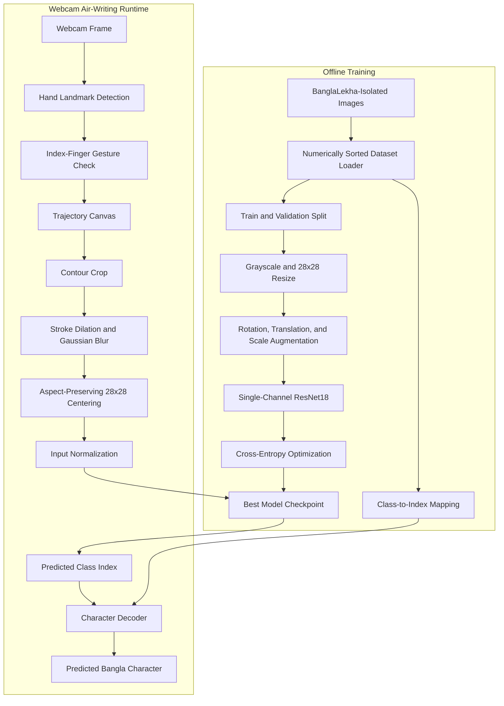
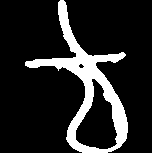

# Air-Writing Bangla Character Recognition

> A webcam-based computer-vision prototype for fingertip trajectory capture and isolated Bangla character classification.

[](https://www.python.org/)
[](https://pytorch.org/)
[](https://opencv.org/)
[](https://ai.google.dev/edge/mediapipe/solutions/vision/hand_landmarker)

## Overview

This project explores touch-free Bangla character input using a standard webcam. It combines hand-landmark detection, index-finger trajectory tracking, virtual-canvas drawing, image preprocessing, and CNN-based isolated-character classification.

The intended workflow is:

1. detect a hand in the webcam frame;
2. track the index fingertip;
3. draw its trajectory on a virtual canvas;
4. crop and normalize the completed trajectory;
5. classify it with a grayscale ResNet18 model; and
6. decode the predicted class into a Bangla character.

The repository should currently be treated as an **experimental computer-vision prototype**. Training and inference code are present, but the trained model weights, dataset, complete evaluation evidence, dependency lock file, and real air-writing test results are not committed.

---

## Project Status

| Component | Implementation | Repository status |
|---|---|---|
| Dataset loader | Custom numerically sorted `ImageFolder` | Implemented |
| Data augmentation | Rotation, translation, and scale perturbation | Implemented |
| CNN training | Grayscale ResNet18 trained from scratch | Implemented in code |
| Validation | Random 15% image-level validation split | Implemented in code |
| Best-checkpoint saving | Saves highest-validation-accuracy state dictionary | Implemented |
| Hand tracking | cvzone/MediaPipe hand landmarks | Implemented |
| Gesture-controlled drawing | Index-finger-only drawing gesture | Implemented in `main.py` |
| Canvas preprocessing | Crop, dilation, blur, aspect-preserving resize, centering | Implemented |
| Character decoding | Folder-index-to-character mapping | Implemented, requires verification |
| Trained weights | `bangla_resnet18.pth` | **Not committed** |
| Training metrics/logs | Accuracy history, loss curves, test metrics | **Not committed** |
| Webcam evaluation | Accuracy/latency on independently drawn trajectories | **Not performed in repository** |
| Demo screenshot/video | Real air-writing run | **Not committed** |

---

## System Architecture



### Runtime Sequence

```text
Webcam
   |
   v
Hand landmarks
   |
   v
Index-finger trajectory
   |
   v
Virtual drawing canvas
   |
   v
Crop -> thicken -> smooth -> resize -> center -> normalize
   |
   v
ResNet18 inference
   |
   v
Class mapping -> Bangla character
```

---

## Computer-Vision Pipeline

### 1. Hand and Fingertip Tracking

`main.py` uses `cvzone.HandTrackingModule.HandDetector`, which is built on MediaPipe hand landmarks. Drawing occurs when the detected finger-state vector is:

```python
[0, 1, 0, 0, 0]
```

This represents an index-finger-only gesture and reduces accidental strokes while repositioning the hand.

### 2. Virtual Canvas

A white canvas matching the webcam frame is maintained in memory. Consecutive index-fingertip positions are connected with black line segments. The drawing mask is composited with the mirrored webcam frame for visual feedback.

### 3. Drawing Preprocessing

When the user requests prediction, `main.py`:

1. converts and inverts the canvas;
2. locates nonzero drawing pixels;
3. crops the drawing to its bounding rectangle;
4. dilates the strokes with a `3 x 3` kernel;
5. applies Gaussian smoothing;
6. resizes while preserving aspect ratio;
7. centers the result on a `28 x 28` canvas; and
8. converts the image to a model input tensor.

### 4. Character Classification

The training code initializes ResNet18 without pretrained weights and modifies it for grayscale input and the detected number of dataset classes:

```python
model = models.resnet18(weights=None)
model.conv1 = nn.Conv2d(
    1, 64,
    kernel_size=7,
    stride=2,
    padding=3,
    bias=False
)
model.fc = nn.Linear(
    model.fc.in_features,
    number_of_classes
)
```

The network is optimized using cross-entropy loss, AdamW, and a validation-loss learning-rate scheduler.

---

## Dataset

The training script expects **BanglaLekha-Isolated**, a public dataset for isolated handwritten Bangla characters.

- **Dataset page:** [BanglaLekha-Isolated on Mendeley Data](https://data.mendeley.com/datasets/hf6sf8zrkc/2)
- **Expected archive:** `BanglaLekha-Isolated.zip`
- **Expected image directory:** `BanglaLekha-Isolated/Images/`
- **Expected folder convention:** Numeric class folders such as `1`, `2`, ..., `84`

The dataset is not included in this repository. Follow its original license and citation requirements when downloading and using it.

### Class Ordering

PyTorch's default `ImageFolder` sorts folder names lexicographically, producing an order such as:

```text
1, 10, 11, ..., 2, 20, ...
```

`train.py` defines `NumericalImageFolder` so numeric folders are ordered numerically before class indices are assigned.

The repository's current `class_to_idx.json` reflects an older lexicographic mapping, while the current training script would write a numerical mapping. Keep the mapping file and model checkpoint from the **same training run** to avoid incorrect character decoding.

---

## Training Configuration

| Setting | Current value |
|---|---:|
| Architecture | ResNet18 from scratch |
| Input channels | 1 grayscale channel |
| Input size | `28 x 28` |
| Batch size | 128 |
| Epochs | 15 |
| Initial learning rate | 0.001 |
| Optimizer | AdamW |
| Weight decay | `1e-4` |
| Validation fraction | 15% |
| Augmentation | Rotation, translation, scale |
| Checkpoint criterion | Highest validation accuracy |

The device selection supports CUDA, Apple Metal Performance Shaders, and CPU execution.

---

## Evaluation Status

The previous project description reported **92.25% validation accuracy**, but the repository does not contain:

- the trained checkpoint;
- console training logs;
- a machine-readable metrics file;
- learning curves;
- a validation confusion matrix;
- per-class precision, recall, or F1-scores; or
- code that evaluates real webcam air-writing samples.

For that reason, the value is not presented here as repository-verifiable evidence.

### Validation Limitation

The current code uses a random image-level split. A stronger evaluation for handwriting recognition should use writer-independent partitions so writing from the same individual cannot influence both training and validation results.

The project also needs a separate **domain-shift evaluation**: BanglaLekha contains handwritten character images, while runtime inputs are webcam-tracked digital trajectories. Good validation performance on dataset images does not automatically imply good performance on air-written trajectories.

---

## Known Technical Issues

These issues should be corrected before presenting the repository as a completed recognition system.

### 1. Missing Model Checkpoint

`main.py` requires `bangla_resnet18.pth` or `bangla_resnet18 (1).pth`, but neither file is committed. The application therefore exits unless the user trains a model or supplies compatible weights.

### 2. Training/Inference Normalization Mismatch

Training applies:

```python
transforms.Normalize((0.5,), (0.5,))
```

The primary inference path currently scales pixels to `[0, 1]` but does not apply the same normalization. This distribution mismatch can reduce prediction quality. Runtime preprocessing should use the exact saved training transform.

### 3. Experimental Script Channel Mismatch

`airwriting_demo.py` converts the grayscale canvas into an RGB image before producing a tensor, while the modified ResNet18 expects one input channel. That script requires correction before use.

### 4. Inconsistent Input Resolution

`train.py` and `main.py` use `28 x 28`, while `airwriting_demo.py` uses `64 x 64`. A single shared preprocessing function should define the input specification.

### 5. Class-Label Verification

The hardcoded Bangla list contains a duplicated compound entry. The exact 84-class character order must be verified against the dataset documentation and saved directly with the checkpoint.

### 6. Bangla Rendering

OpenCV's built-in Hershey fonts do not reliably render Bangla Unicode. Use PIL/Pillow with a bundled Bangla font for the on-frame prediction label.

---

## Repository Assets

The repository currently contains one sample grayscale test image:



This image demonstrates the expected isolated-character style. It is not evidence of the webcam tracking interface or a complete evaluation set.

For a stronger portfolio presentation, add:

- a short GIF of fingertip tracking and drawing;
- a screenshot showing canvas preprocessing stages;
- a validation confusion matrix;
- training/validation loss and accuracy curves; and
- a grid of correct and incorrect air-writing predictions.

---

## Repository Structure

```text
Air-writing-bangla-character-recognition/
|-- airwriting_demo.py       # Alternative experimental MediaPipe runtime
|-- class_to_idx.json        # Current folder-to-class mapping artifact
|-- extract_classes.py       # Legacy checkpoint-inspection utility
|-- main.py                  # Primary cvzone webcam application
|-- README.md                # Project documentation
|-- test.png                 # Sample isolated grayscale input
|-- test_model.py            # Single-image inference utility
`-- train.py                 # Dataset loading, augmentation, training, validation
```

This tree uses ASCII characters to avoid encoding problems in GitHub rendering.

---

## Local Setup

### Prerequisites

- Python 3.10 or newer
- Webcam
- Git

### 1. Clone the Repository

```bash
git clone https://github.com/anushka06onu/Air-writing-bangla-character-recognition.git
cd Air-writing-bangla-character-recognition
```

### 2. Create and Activate a Virtual Environment

```bash
python -m venv .venv
```

```bash
# Linux or macOS
source .venv/bin/activate

# Windows PowerShell
.venv\Scripts\Activate.ps1
```

### 3. Install Dependencies

The repository does not currently include `requirements.txt`. Install the dependencies explicitly:

```bash
pip install torch torchvision opencv-python mediapipe cvzone numpy pillow
```

For reproducibility, generate and commit a version-pinned `requirements.txt` after validating the environment.

### 4. Download the Dataset

Download `BanglaLekha-Isolated.zip` from the dataset page and place it in the repository root.

### 5. Train the Model

```bash
python train.py
```

The script extracts the archive when necessary and writes:

```text
bangla_resnet18.pth
class_to_idx.json
```

Keep these two files together because the mapping must match the checkpoint.

### 6. Run the Primary Webcam Application

```bash
python main.py
```

### Controls

| Action | Control |
|---|---|
| Draw | Raise only the index finger |
| Predict | Press `p` |
| Clear canvas | Press `c` |
| Quit | Press `q` |

---

## Recommended Improvements

The highest-value improvement is not another interface. It is a reproducible evaluation across both source-domain handwriting and target-domain air-writing.

- [ ] Create one shared model-definition and preprocessing module.
- [ ] Apply identical normalization during training and every inference path.
- [ ] Correct or remove the broken alternative demo script.
- [ ] Verify all 84 class labels against official dataset metadata.
- [ ] Save architecture, class list, normalization, input size, and model weights in one versioned checkpoint.
- [ ] Add `requirements.txt` and operating-system setup notes.
- [ ] Save epoch metrics to CSV or JSON and generate learning curves.
- [ ] Report macro-F1, per-class recall, and a confusion matrix.
- [ ] Use writer-independent train, validation, and test partitions where metadata permits.
- [ ] Collect a consented, clearly documented air-writing test set from multiple writers.
- [ ] Compare a small CNN, ResNet18, MobileNetV3, and a lightweight vision-transformer baseline.
- [ ] Measure end-to-end latency and frames per second.
- [ ] Add confidence thresholds and an “uncertain” result.
- [ ] Include a real demonstration GIF and failure-case gallery.

---

## Intended Use and Limitations

This project is suitable for:

- learning webcam-based hand tracking;
- studying trajectory-to-image conversion;
- experimenting with image preprocessing;
- training multiclass CNNs; and
- prototyping accessible Bangla input interfaces.

It is not yet validated for production assistive input, educational assessment, or unrestricted real-world handwriting recognition.

---

## What This Project Demonstrates

- Webcam frame processing with OpenCV.
- Hand-landmark and fingertip tracking.
- Gesture-controlled trajectory capture.
- Morphological and geometric image preprocessing.
- Grayscale CNN adaptation in PyTorch.
- Model checkpointing and class-index management.
- Awareness of source-to-target domain shift between handwritten images and air-written trajectories.

---

## Author

Developed by **Fateha Hossain Anushka**
