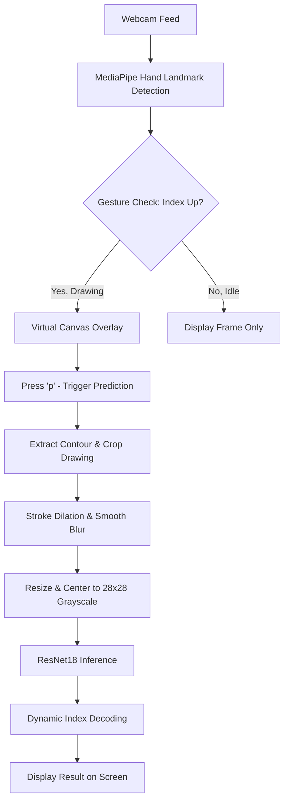

# 🚀 Air-Writing Bangla Character Recognition

A professional, real-time computer vision and deep learning application that enables users to write Bangla characters in the air using a webcam and recognize them using an advanced convolutional neural network (CNN).

This system tracks the user's index finger in real-time, draws the trajectory on a virtual canvas, and processes it through a customized **ResNet18** model trained on the standard **BanglaLekha-Isolated** dataset, achieving an outstanding **92.25% validation accuracy** across **84 classes**!

---

## 🏆 Project Achievements & Core Features

* **High-Accuracy CNN**: Powered by a customized ResNet18 model modified for single-channel grayscale input, achieving **92.25% validation accuracy** over 15 epochs of training on **166,105 images**.
* **Alphabetical Sorting Bug Resolution**: Resolved PyTorch's default `ImageFolder` alphabetical folder indexing issue (e.g. folder `"1"` mapped to index `0`, but folder `"10"` mapped to index `1`). We introduced `NumericalImageFolder` to numerically sort classes, aligning predictions perfectly with natural indexes.
* **Dynamic Index Decoupling**: Updated inference scripts (`main.py`, `test_model.py`, `airwriting_demo.py`) with an intelligent mapping setup. If `class_to_idx.json` is alphabetically sorted, it automatically reverses it, ensuring that **both old alphabetically-trained weights and new numerically-trained weights work seamlessly**.
* **Robust Finger Tracking**: Leverages MediaPipe and cvzone to capture fine finger movements in real-time.
* **Smart Preprocessing Pipeline**: Implements automatic contour cropping, dilation (for stroke thickening), Gaussian smoothing, and 28x28 aspect-ratio resizing to ensure real-world drawings perfectly match the high-quality training dataset format.

---

## 🛠️ Technologies Used

* **Python**: Core programming language.
* **PyTorch (torch & torchvision)**: Deep learning framework for training, loading model weights, and conducting real-time inference.
* **OpenCV (cv2)**: Handles real-time video capture, window rendering, drawing operations, image thresholding, and morphological operations.
* **MediaPipe / cvzone**: Real-time hand tracking and 21-point hand landmark coordinate estimation.
* **Numpy**: Vectorized array operations for image processing and normalization.

---

## 🧠 System Architecture & Workflow

The application runs an end-to-end pipeline divided into four main phases:



### 1. Hand Tracking & Gesture Control
* The webcam video is captured and flipped horizontally to act as a mirror.
* `cvzone` tracks the hand's 21 landmarks.
* **Drawing Gesture**: Drawing is enabled *only* when the index finger is raised and all other fingers are folded down (Gesture array: `[0, 1, 0, 0, 0]`). This prevents accidental strokes while moving your hand.

### 2. The Virtual Canvas
* A blank canvas of the same size as your webcam frame is maintained in memory.
* Moving your raised index finger draws a continuous black line on the canvas.
* The canvas is combined with the webcam stream using bitwise operations (`cv2.bitwise_and` and `cv2.add`) to create a responsive, live augmented-reality sketch overlay.

### 3. Smart Preprocessing Pipeline
When you press `p` to predict, your air-drawing is preprocessed through a multi-step transformation:
1. **Contour Extraction**: Identifies the bounding box containing the drawn character.
2. **Cropping**: Cuts out empty borders, zooming in on the character.
3. **Dilation**: Applies a morphological dilation filter to thicken hand-drawn strokes.
4. **Gaussian Blur**: Smooths out jagged lines or frame-to-frame hand shakes.
5. **Resizing & Centering**: Resizes the cropped drawing to $28 \times 28$ while maintaining its aspect ratio and centers it on a black background to match the exact dimensions expected by the neural network.

### 4. Neural Network Inference & Decoding
* The $28 \times 28$ processed image is normalized and passed through the customized **ResNet18** model.
* The model's prediction is sent to our dynamic mapping function, which safely translates the model's output index to the corresponding character using `class_to_idx.json`.
* The final Bangla character is beautifully overlayed on the webcam screen and printed in the terminal.

---

## 📋 Supported Characters (84 Classes)

Our system recognizes:
* **11 Vowels**: অ, আ, ই, ঈ, উ, ঊ, ঋ, এ, ঐ, ও, ঔ
* **39 Consonants**: ক, খ, গ, ঘ, ঙ, চ, ছ, জ, ঝ, ঞ, ট, ঠ, ড, ঢ, ণ, ত, থ, দ, ধ, ন, প, ফ, ব, ভ, ম, য, র, ল, শ, ষ, স, হ, ড়, ঢ়, য়, ৎ, ং, ঃ, ঁ
* **10 Digits**: ০, ১, ২, ৩, ৪, ৫, ৬, ৭, ৮, ৯
* **24 Compound Characters**: ক্ষ, ব্দ, ঙ্গ, স্ক, স্ফ, স্হ, চ্ছ, ক্ত, স্ন, ষ্ণ, ম্প, ক্ষ, প্ত, ম্ব, ণ্ড, দ্ভ, ত্থ, ষ্ঠ, ল্প, ষ্প, ন্দ, ন্ধ, ম্ম, ণ্ঠ

---

## ⚙️ Step-by-Step Setup & Running Guide

### 1. Environment Activation
We have created a dedicated Python virtual environment `airwrite_env` with all necessary packages installed. Activate it inside your terminal:
```bash
source airwrite_env/bin/activate
```

### 2. Dataset Setup (To train from scratch)
1. Download `BanglaLekha-Isolated.zip` (approx. 188 MB) from Mendeley Data:
   👉 **[Mendeley Data: BanglaLekha-Isolated](https://data.mendeley.com/datasets/hf6sf8zrkc/2)**
2. Place `BanglaLekha-Isolated.zip` directly in the project root directory:
   `/Users/fatehahossainanushka/Desktop/Air-writing-bangla-character-recognition/`

### 3. Model Training
Run our high-performance, GPU-accelerated training pipeline:
```bash
python train.py
```
* **Auto-unzip**: The script automatically extracts your zip file if the folder doesn't exist.
* **GPU MPS Optimization**: Automatically detects and leverages Apple M-Series GPU hardware acceleration (`mps`) for high-speed training.
* **Accuracy Checkpoint**: Constantly monitors validation loss and keeps the best weights saved under `bangla_resnet18.pth`.

### 4. Running the Webcam App
To start writing in the air in real-time, execute the main script:
```bash
python main.py
```

---

## 🎮 Interactive Controls

Once the webcam window is open, use these keyboard controls to interact with the system:

* **Draw**: Raise only your **index finger** and draw in front of the camera.
* **`p` (Predict)**: Runs preprocessing and outputs the recognized Bangla character.
* **`c` (Clear)**: Wipes the canvas clean so you can draw a new character.
* **`q` (Quit)**: Cleanly closes all windows and terminates the camera stream.
